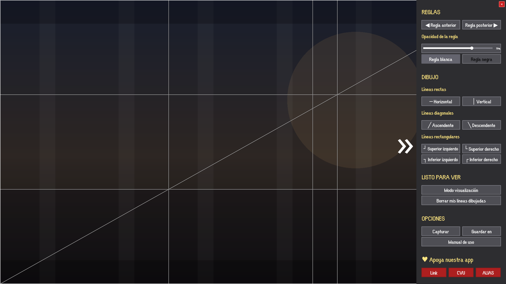
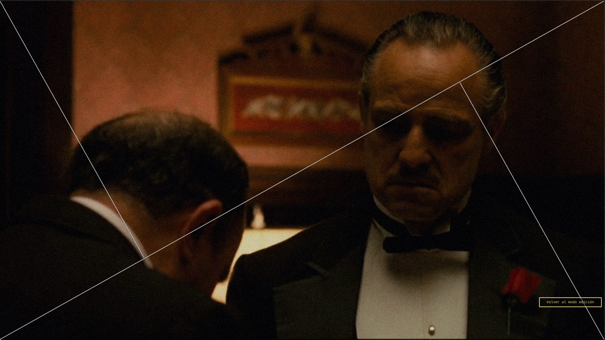
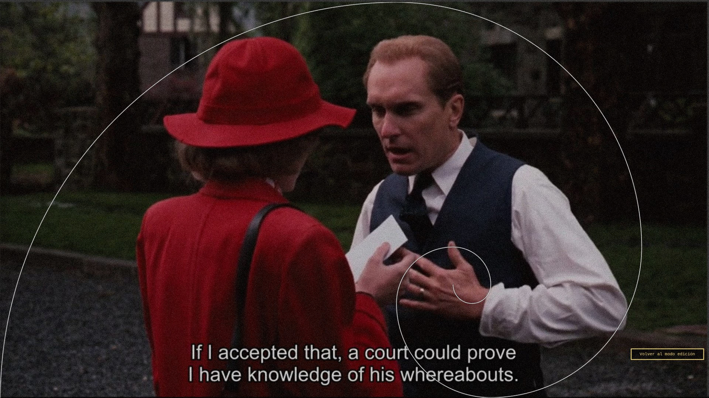
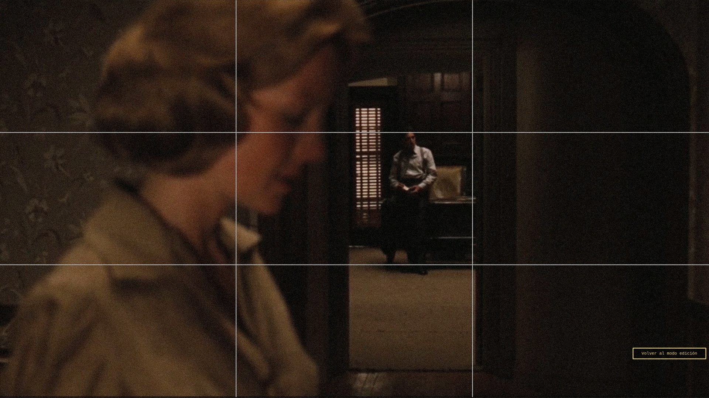
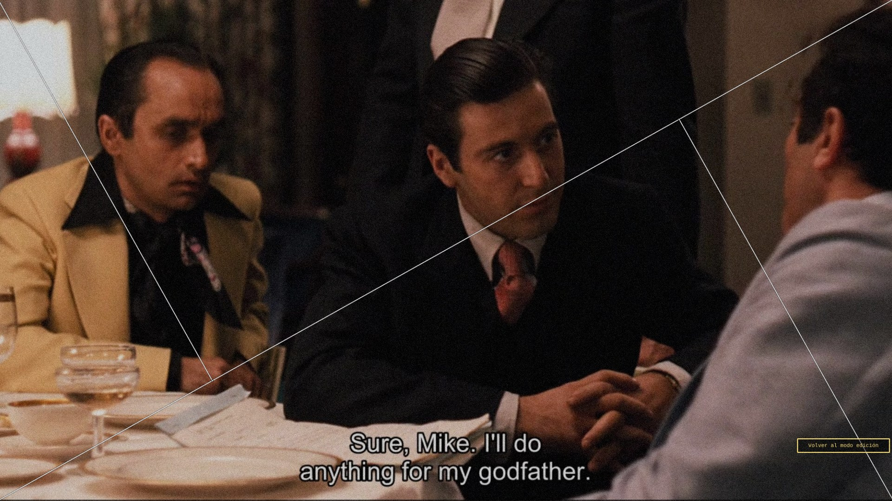
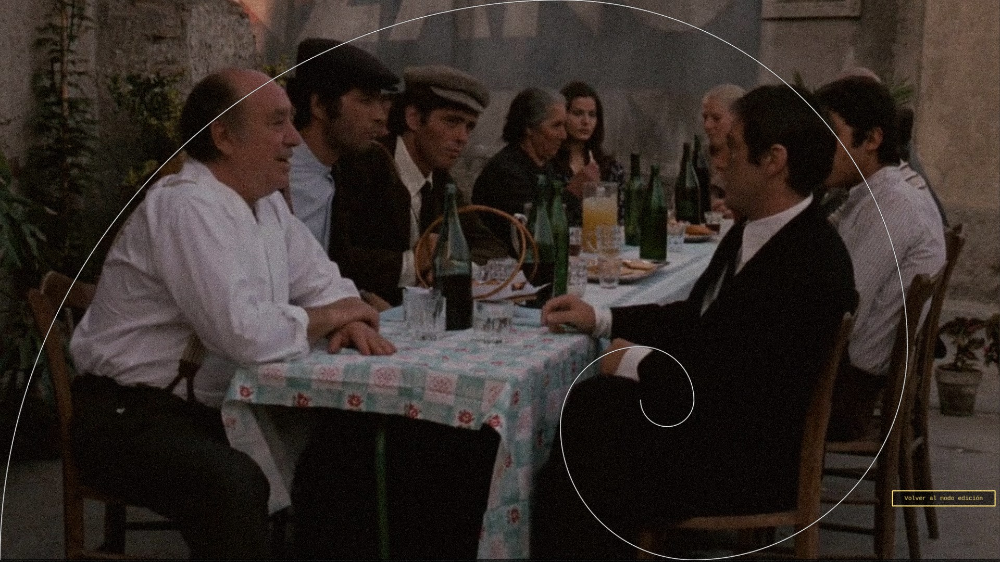
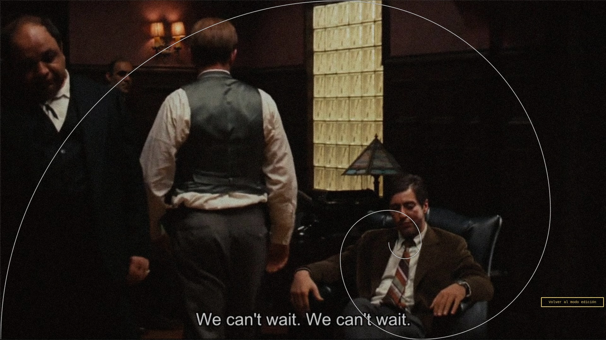

# ALEPH

Superposición transparente de guías de composición en la pantalla. Útil
para el análisis y estudio de la fotografía cinematográfica viendo
películas, series y anime.



## CARACTERÍSTICAS

- Pool con 10 guías preestablecidas: regla de tercios, triángulos áureos,
  espirales de Fibonacci, centro y diagonales. Incluye un espacio vacío
  para trabajar solo con las reglas propias.

- Definición de reglas personalizadas por el usuario.

- Modo pasivo (click-through): la ventana deja de capturar el ratón y
  los clics pasan al contenido de abajo.

- Ventana redimensionable, para ajustar los marcos a diferentes
  resoluciones.

- Captura de pantalla limpia con las guías y reglas superpuestas.

- Acceso directo en el Escritorio y registro en el menú de aplicaciones
  en la primera ejecución.

## GALERÍA

Las guías de Aleph sobre una película, en modo pasivo: la overlay no
intercepta el ratón ni las teclas, así que la película sigue siendo lo
que estás mirando.

<table>
  <tr>
    <td width="50%"><a href="docs/aleph-01.jpg"></a></td>
    <td width="50%"><a href="docs/aleph-02.jpg"></a></td>
  </tr>
  <tr>
    <td width="50%"><a href="docs/aleph-03.jpg"></a></td>
    <td width="50%"><a href="docs/aleph-04.jpg"></a></td>
  </tr>
  <tr>
    <td width="50%"><a href="docs/aleph-05.jpg"></a></td>
    <td width="50%"><a href="docs/aleph-06.jpg"></a></td>
  </tr>
  <tr>
    <td width="50%"><a href="docs/aleph-07.jpg"></a></td>
    <td width="50%"><a href="docs/aleph-08.jpg"></a></td>
  </tr>
  <tr>
    <td width="50%"><a href="docs/aleph-09.jpg"></a></td>
    <td width="50%"><a href="docs/aleph-10.jpg"></a></td>
  </tr>
</table>

## INSTALACIÓN

### Binarios (sin Python)

Descargá el binario de tu sistema desde la pestaña Releases del
repositorio:

<https://github.com/LucasLassa/aleph/releases>

- Linux x86_64
- Windows x86_64
- macOS arm64

En Linux, dale permisos de ejecución con `chmod +x`.
En macOS sin firmar, hacé clic derecho → Abrir (Gatekeeper).
En Windows, "Ejecutar de todas formas" (SmartScreen).

### Desde el código

Requisitos:

- Python ≥ 3.11
- PySide6 ≥ 6.5
- En Wayland: grim (para la captura de pantalla)

Instalación recomendada (venv):

```bash
python -m venv .venv
source .venv/bin/activate
pip install -e .[dev]
aleph
```

En Arch Linux o entornos con PEP 668, si preferís instalar en el
usuario:

```bash
pip install --user --break-system-packages -e .[dev]
aleph
```

También podés correrlo sin instalar:

```bash
python -m src.main
```

En Linux (vía pip, fuera de un binario) la app se desacopla de la terminal al arrancar:
si la lanzás con `kitty -e aleph`, la consola se cierra sola y la overlay sigue viva.

## USO RÁPIDO

La ventana se abre a pantalla completa, adaptada al monitor, con el
marco activo.

### Atajos

| Tecla | Acción |
|---|---|
| `←` / `→` | Guía anterior / siguiente |
| `↑` / `↓` | Subir / bajar opacidad (pasos de 0.05) |
| `M` | Alternar modo marco (edición ↔ pasivo) |
| `Shift + F` | Desbloquear / bloquear fullscreen |
| `Shift + Backspace` | Borrar las reglas propias |
| `Shift + S` | Captura de pantalla con las líneas |
| `Shift + C` | Alternar color de las líneas (blanco / negro) |
| `Esc` | Cerrar la aplicación |
| `Shift + clic izq.` | Colocar / mover una regla propia |

Las teclas se configuran en `src/core/keymap.py`.

### Panel lateral

Con el marco activo, se muestra un panel a la derecha que se despliega,
organizado en secciones:

- **Reglas**: guía anterior/posterior, opacidad y color de las líneas.
- **Dibujo**: botones para crear reglas propias (rectas, diagonales
  y vértices).
- **Listo para ver**: modo visualización (pasivo) y borrar las líneas
  propias.
- **Opciones**: captura de pantalla, carpeta de guardado y manual de uso.
- **Apoya nuestra app**: link de donación, CVU y alias (al portapapeles).

### Modo pasivo

Con `M` (o el botón "Modo visualización") la overlay quita todo el cromo
y deja solo las guías. Abajo a la derecha aparece un botón "Volver al
modo edición".

Los atajos con Shift siguen funcionando con el marco OFF. El teclado
también responde sin botones visibles: `←` `→`, `↑` `↓`, `Shift + C` y `Esc`.

## REGLAS PROPIAS

Además de las guías preestablecidas, podés crear líneas de composición a
medida. Los botones del panel se agrupan en rectas (horizontal y
vertical), diagonales (ascendente y descendente) y vértices (cuatro
esquinas).

### Cómo se colocan

1. Pulsá el botón del tipo de regla que quieras.
2. Mantené `Shift` y arrastrá con clic izquierdo hasta donde quieras el
   vértice.
3. Al soltar `Shift`, la regla queda fija.

Las diagonales no tienen vértice: son líneas completas. Si hacés
`Shift` + clic sobre una diagonal existente, la agarrás y la movés
arrastrando. Si hacés `Shift` + clic sin haber pulsado antes un botón,
no se crea nada.

### Cómo se borran

`Shift + Backspace` (o el botón "Borrar mis líneas dibujadas" del panel)
borra todas las reglas propias. Las guías preestablecidas no se tocan.

Las reglas se guardan en proporción (no en píxeles), así que sobreviven
a un redimensionado.

### Espacio vacío

La guía "Espacio vacío" no dibuja ninguna línea preestablecida: queda
el lienzo limpio. Es útil para las capturas: con `Shift + S` en modo
"Espacio vacío" sale la foto limpia con solo tus reglas encima.

## CAPTURAS DE PANTALLA

`Shift + S` (o el botón "Capturar") guarda una foto con la guía activa y
las reglas superpuestas. La foto sale limpia: se captura la pantalla sin
la overlay y las líneas se pintan después.

- Se guarda en Descargas, o en la carpeta elegida con "Guardar en".
- Nombres: `aleph-AAAAMMDD-HHMMSS.png`.

En Wayland es necesario `grim`: el protocolo no deja que una app lea la
pantalla, así que se delega en esa herramienta.

## REDIMENSIONAR LA VENTANA

`Shift + F` desbloquea el fullscreen y aparecen tiradores en las esquinas.
Arrastralos para redimensionar. `Shift + F` de nuevo devuelve la ventana a
pantalla completa.

## LIMITACIONES CONOCIDAS

En Hyprland el click-through del modo pasivo no funciona: el
compositor ignora las input regions en toplevels. El botón "Volver al
modo edición" no es clicable ahí; usá `M` o la señal SIGUSR1:

```ini
bind = SUPER, B, exec, pkill -USR1 -x -f aleph
```

En Hyprland la ventana tampoco queda siempre arriba por sí sola: hace
falta una regla que la fije. La class de la ventana sale del nombre del
binario, así que tiene que ser `aleph`:

```ini
hl.window_rule({
    name = "aleph",
    match = { class = "aleph" },
    pin = true,
    no_blur = true,
})
```

En Wayland, la captura requiere `grim` instalado.
En Windows y macOS el click-through funciona, pero no sobre juegos en
fullscreen exclusivo. Sin firma, SmartScreen y Gatekeeper piden
confirmación.

## CONFIGURACIÓN

La configuración se guarda en
`~/.config/aleph/config.json` al cerrar la app: opacidad,
color de líneas y carpeta de capturas.

No se persisten el modo marco, la guía activa, el modo fullscreen ni las
reglas. La app arranca siempre con marco ON, en la regla de tercios, a
pantalla completa y sin reglas.

## DESARROLLO

```bash
pip install -e .[dev]
python -m pytest
ruff check src tests
```

Para generar los binarios:

```bash
pip install -e .[dev]
pyinstaller aleph.spec
# Linux/Windows: dist/aleph(.exe)    [onefile]
# macOS:         dist/aleph.app       [onedir + bundle]
```

Estructura:

```
src/
├── main.py              # punto de entrada
├── app.py               # config + estado + plataforma + ventana
├── ui/                  # ventana, paintEvent, íconos
├── core/                # estado, guías, reglas, captura, keymap
├── platform/            # backends por SO (Qt genérico, Wayland)
├── config/              # defaults + load/save
└── utils/               # logger, geometría (Fibonacci, perpendicular)
```

## DONACIONES

La app incluye un grupo de donación en la franja del panel lateral
(link de Mercado Pago + alias + CVU al portapapeles).
Si te sirve el proyecto, podés invitarme un café desde ahí.

## LICENCIA

MIT. Ver LICENSE.
